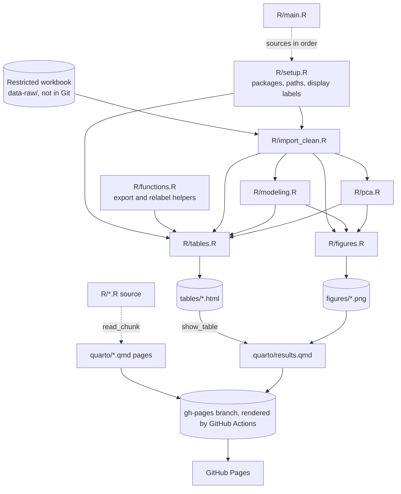

# Architecture

## Overview

This repository reproduces a published case–control analysis of antibody profiles in organ transplant recipients with and without cryptococcosis (Yoon et al., *Open Forum Infectious Diseases* 2022). The original 2022 R Markdown analysis was split into R scripts, run in a fixed order by `R/main.R`, and documented on a Quarto website served by GitHub Pages.

Two boundaries shape the design:

- **The analysis code is frozen.** Scripts reproduce the published analysis unchanged. The only additions are the workbook path, names for results the R Markdown file printed inline, and code that exports and labels tables and figures (see `AGENTS.md`).
- **The data never enter Git.** The restricted workbook is read from `data-raw/` (ignored) or another local path. Only cleared outputs in `tables/` and `figures/` are committed; the rendered site is published to the `gh-pages` branch, not committed.

The scientific specification is in `analysis-plan.md`; the intended layout is in `REPOSITORY-BLUEPRINT.md`.

## Architecture Diagram

## Components

Scripts are listed in the order `R/main.R` sources them. Each script's header comment records what it needs, what it produces, and which chunk of the original R Markdown file it came from.

### Setup

**Purpose**: Attach every package the published analysis used, define the workbook location and output folders, and define the readable labels used in exported tables.

**Location**: `R/setup.R`

**Key symbols**:
- `raw_data_path`, `raw_data_sheet`: the workbook location.
- `tables_dir`, `figures_dir`: the output folders.
- `display_variable_labels`: a named vector mapping analysis variable names (for example `AGE`, `log_GXMIgM`) to display names with units.
- `display_level_labels`: a list mapping category codes to display values for sex, race, the drug indicators and CNS disease.
- Chunk labels `load-packages`, `define-constants`, `define-display-labels`.

**Interactions**: Read by every later script. It is the only place to change where the workbook lives or how variables are named in exported tables. The analysis itself uses the original variable names.

### Helper functions

**Purpose**: Label, save and summarize tables. None of them changes an estimate.

**Location**: `R/functions.R`

**Key symbols**:
- `save_gtsummary_html()`: saves a gtsummary table as HTML via gt.
- `relabel_table()`: rewrites only the label column of a gtsummary table, replacing variable names on label rows and category codes on level rows; anything without a display label is left as it is.
- `save_flextable_html()`: saves a data frame as an HTML flextable.
- `summarise_cutpoint()`: one row per cutpointr result.
- `summarise_auc_ci()`: one row per ROC curve, with DeLong and bootstrap intervals.

**Interactions**: Used only by `R/tables.R`.

### Import and cleaning

**Purpose**: Read the workbook and derive every analysis variable.

**Location**: `R/import_clean.R` (from the original `dataimport` chunk)

**Key symbols**:
- `RawData`: the workbook as read.
- `CleanData`: all analysed participants. It holds the derived drug indicators, the numeric CrAg titer, CNS disease, `HasCryptococcus` and log-transformed antibodies, after one control is excluded.
- `CleanData_NoMissingTiters`: participants with antibody measurements.
- `CategoricalVariables`, `TiterVariables`, `LogTiterVariables`, `ContinuousVariables`: the variable lists the later scripts select by.

**Interactions**: Receives the path from Setup. Feeds every analysis and output script.

### Regression, ROC and cutpoints

**Purpose**: Fit the univariable and multivariable logistic models, the ROC curves with AUC confidence intervals, the sensitivity models, and the optimal titer cutpoints.

**Location**: `R/modeling.R` (from the original `regressiontables` chunk)

**Key symbols**:
- Models: `mvtitermodel1`, `mvlogtitermodel1`–`mvlogtitermodel4`.
- gtsummary tables: `regression_table_titer`, `regression_table_logtiter_1`, `regression_table_logtiter_2`, `sensitivity_table_log_lam_igm`, `sensitivity_table_log_gxm_igm`.
- ROC objects: `titer_roc`, `logtiter_roc1`, `logtiter_roc2`.
- AUC intervals: `auc_ci_logtiter1_*`, `auc_ci_logtiter2_*`.
- Cutpoints: `cutpoint_gxm_igm`, `cutpoint_log_gxm_igm`, `cutpoint_lam_igm`, `cutpoint_log_lam_igm`.

**Interactions**: Uses `CleanData` and the variable lists. Its outputs go to Tables (tables and summaries) and Figures (ROC curves). `regression_table_logtiter_1` is computed but not exported, because its content is contained in `regression_table_logtiter_2`.

### Principal component analysis

**Purpose**: Run PCA on the seven log antibodies, then regress case status on the components.

**Location**: `R/pca.R` (from the original `corrplot1` chunk)

**Key symbols**: `PCA` (a prcomp object), `columns` (the component scores), `PCAData`, `pc_regression_table`.

**Interactions**: Uses `CleanData_NoMissingTiters`. Feeds Tables (the eigenvalue and regression tables) and Figures (the PCA plots and the component correlation plot).

### Tables

**Purpose**: Build Table 1 and the descriptive summaries, then export every cleared table.

**Location**: `R/tables.R` (from the `exploratoryanalysis` and `corrplot1` chunks, plus the export code)

**Key symbols**: `table1_all`, `table1_no_missing_titers`, `pca_eigenvalue_table`, `auc_ci_summary`, `cutpoint_summary`. Chunk `export-tables` writes the HTML files.

**Interactions**:
- Each gtsummary table is passed through `relabel_table()` with the display labels from Setup at the moment it is saved. The table objects in memory keep the original names.
- The AUC, cutpoint and eigenvalue tables are saved as flextables without relabeling; their labels are written in the code.
- `crag_titer_counts` and `crag_result_counts` are computed for internal checking only and are never exported, because they contain single-patient cells.

### Figures

**Purpose**: Draw and export every figure.

**Location**: `R/figures.R` (from the `factetedplots` and `corrplot1` chunks, plus the export code)

**Key symbols**:
- `faceted_titer_plot`: antibody levels by case status.
- `pca_individuals_plot`, `pca_biplot`.
- Chunks `roc-curves`, `correlation-plots` and `pca-component-correlation` draw base-graphics plots into `png()` devices.

**Interactions**: Writes `figures/*.png`. Figures are not affected by the display labels, which apply to tables only.

### Quarto website

**Purpose**: Explain each script's code and show the cleared results. The website never runs the analysis.

**Location**: `_quarto.yml`, `index.qmd`, `quarto/*.qmd`, `_extensions/coatless-quarto/custom-callout/`, `references.bib`

**How it works**:
- Each script page loads its script with `knitr::read_chunk("../R/<script>.R")` in a hidden chunk and shows each labelled section with `eval: false`.
- `quarto/results.qmd` defines a hidden `show_table()` helper. For each saved file in `tables/`, it takes the HTML body and places it directly in the page inside a horizontally scrolling container, so tables size to their content. Figures are linked from `figures/`.
- `_quarto.yml` lists `tables/*.html` and `figures/*.png` as `resources`, so they are copied into the rendered site.
- Global `execute: eval: false` keeps analysis code from running during rendering. Only the `read_chunk()` imports and the Results page's `show_table()` calls are evaluated, and those read files only.

**Interactions**: Renders to `docs/` locally, which is not committed. `.github/workflows/publish.yml` renders the site on every pull request as a check and, on each push to `master`, publishes it to the `gh-pages` branch, which GitHub Pages serves.

## Data Flow

1. `R/import_clean.R` reads the workbook (sheet `Data`) into `RawData`.
2. Cleaning produces `CleanData` (23 cases, 21 controls) and the complete-antibody subset `CleanData_NoMissingTiters`.
3. `R/modeling.R` fits models on `CleanData`; complete-case handling is left to `glm`. `R/pca.R` works on the complete-antibody subset.
4. `R/tables.R` relabels the gtsummary tables for display and saves them, with the other tables, to `tables/`. `R/figures.R` saves the figures to `figures/`.
5. An authorized person reviews those outputs, previews the site with `quarto render`, and commits `tables/` and `figures/`; GitHub Actions publishes the site when the change reaches `master`. The Results page then reads the saved tables into the page.

No intermediate objects are saved to disk. Every run starts from the workbook in a fresh R session.

## Configuration

| Setting | Where | Notes |
|---|---|---|
| Workbook path and sheet | `R/setup.R` (`raw_data_path`, `raw_data_sheet`) | Default `data-raw/…`, which is ignored by Git |
| Output folders | `R/setup.R` (`tables_dir`, `figures_dir`) | Both are tracked; contents are cleared outputs |
| Display labels for exported tables | `R/setup.R` (`display_variable_labels`, `display_level_labels`) | Presentation only; edit here to rename a variable or category in every table |
| Ignored paths | `.gitignore` | `data-raw/`, `Archive/`, data-file extensions, `Rplots.pdf`, Office lock files |
| Site settings | `_quarto.yml` | Theme, sidebar, bibliography, `resources`, global `eval: false` |
| Package installation | `R/setup.R`, README | `bstfun` is installed from GitHub; package versions are not pinned |

## Code References

| Component | File | Key symbols / chunk labels |
|---|---|---|
| Entry point | `R/main.R` | sources scripts in order |
| Setup | `R/setup.R` | `load-packages`, `define-constants`, `define-display-labels` |
| Helpers | `R/functions.R` | `save_gtsummary_html()`, `relabel_table()`, `save_flextable_html()`, `summarise_cutpoint()`, `summarise_auc_ci()` |
| Import and cleaning | `R/import_clean.R` | `import-data`, `clean-data`, `define-variable-lists`, `log-transform-titers`, `convert-factors`, `exclude-missing-titers` |
| Modeling | `R/modeling.R` | `univariate-titer-models`, `multivariable-titer-model`, `roc-titer-model`, `univariate-log-titer-models`, `multivariable-log-titer-models`, `roc-log-titer-models`, `sensitivity-single-antibody-models`, `optimal-cutpoints` |
| PCA | `R/pca.R` | `fit-pca`, `pca-scores`, `pca-regression` |
| Tables | `R/tables.R` | `table-1`, `cryptococcal-antigen-counts`, `pca-eigenvalues`, `summarise-roc-and-cutpoints`, `export-tables` |
| Figures | `R/figures.R` | `setup-figures-dir`, `faceted-titer-plot`, `roc-curves`, `correlation-plots`, `pca-plots`, `pca-component-correlation` |
| Results page | `quarto/results.qmd` | `show_table()` |
| Site pages | `quarto/*.qmd` | one page per script, plus `background`, `results`, `about` |

Original R Markdown chunk → script: `library` → `setup.R`; `dataimport` → `import_clean.R`; `exploratoryanalysis` → `tables.R`; `factetedplots` → `figures.R`; `regressiontables` → `modeling.R`; `corrplot1` → `pca.R`, `figures.R` and `tables.R`. The `citations` chunk was not carried over; citations are in `references.bib`.

## Glossary

| Term | Definition |
|---|---|
| GXM | Glucuronoxylomannan, the main capsular polysaccharide of *Cryptococcus neoformans* |
| Lam | Laminarin, an algal β-glucan used as a stand-in for fungal cell-wall β-glucan |
| GXM-IgM, Lam-IgM, … | Antibodies binding GXM or laminarin, reported as inverse titers |
| IgM, IgG1, IgG2 | Total (non-specific) immunoglobulins, in µg/mL |
| CrAg | Cryptococcal antigen |
| Frozen code | Published analysis code that is not changed (see `AGENTS.md`) |
| Cleared output | A table or figure a decider has approved for public release |
| Display label | A readable name for a variable or category, applied only when a table is exported |
| PC1 | First principal component, a summary score of overall antibody level with inverted sign |

## Revision scope

Generated with the describe-design workflow on 2026-10-27, describing branch `table-presentation` (based on `master` at `a55496b`, with the display-label and inline-table changes).
