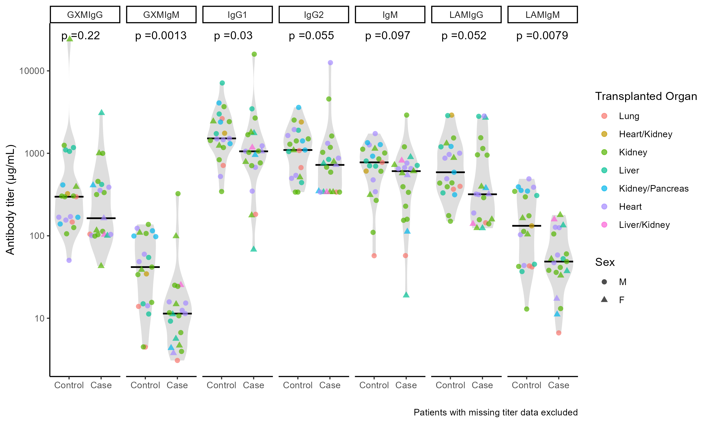
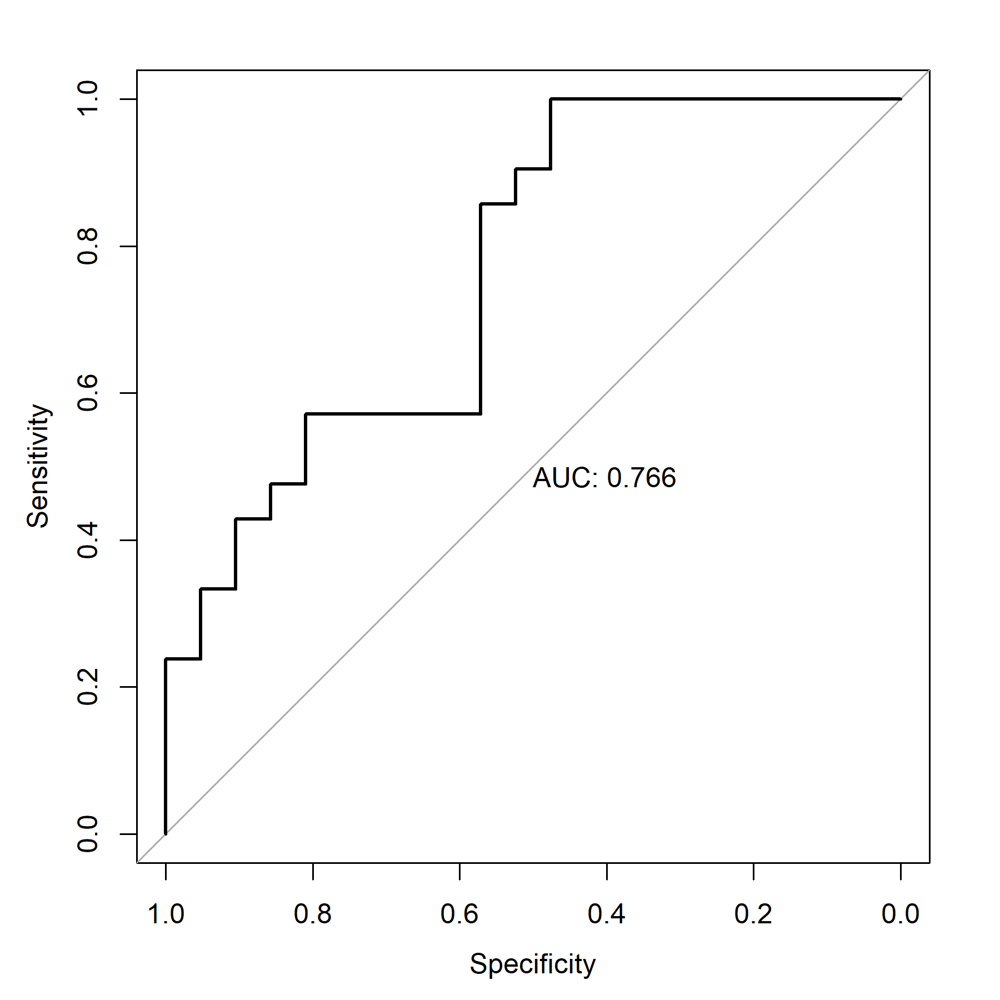
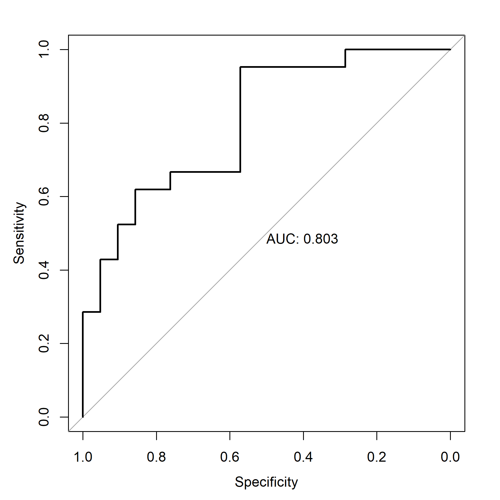
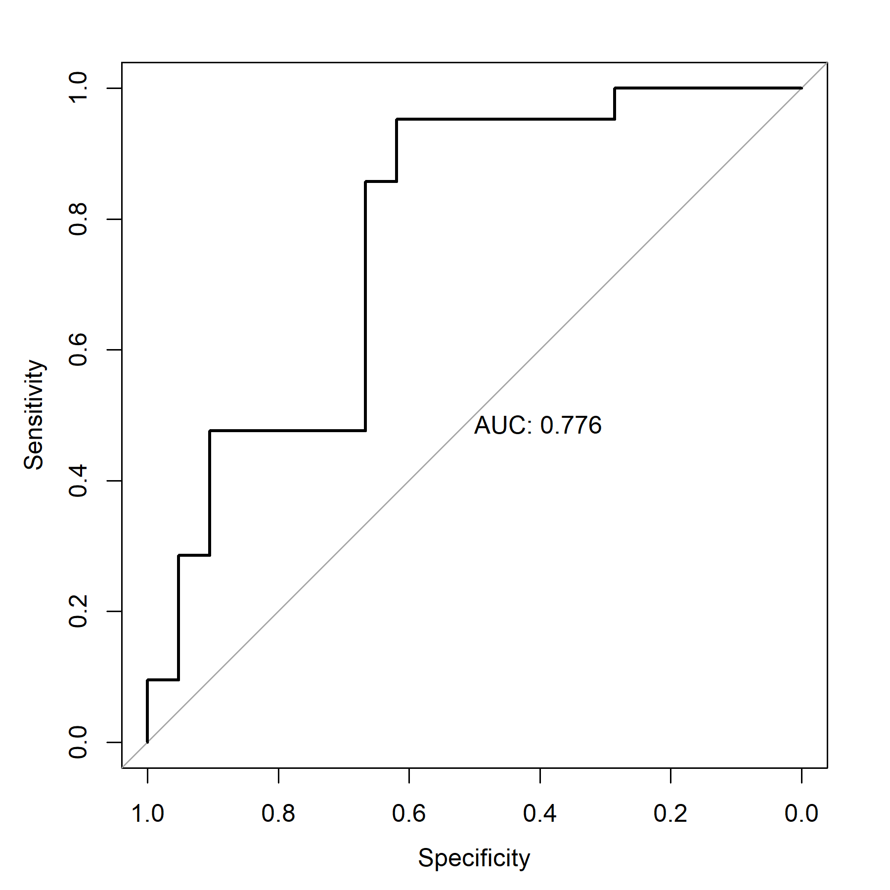
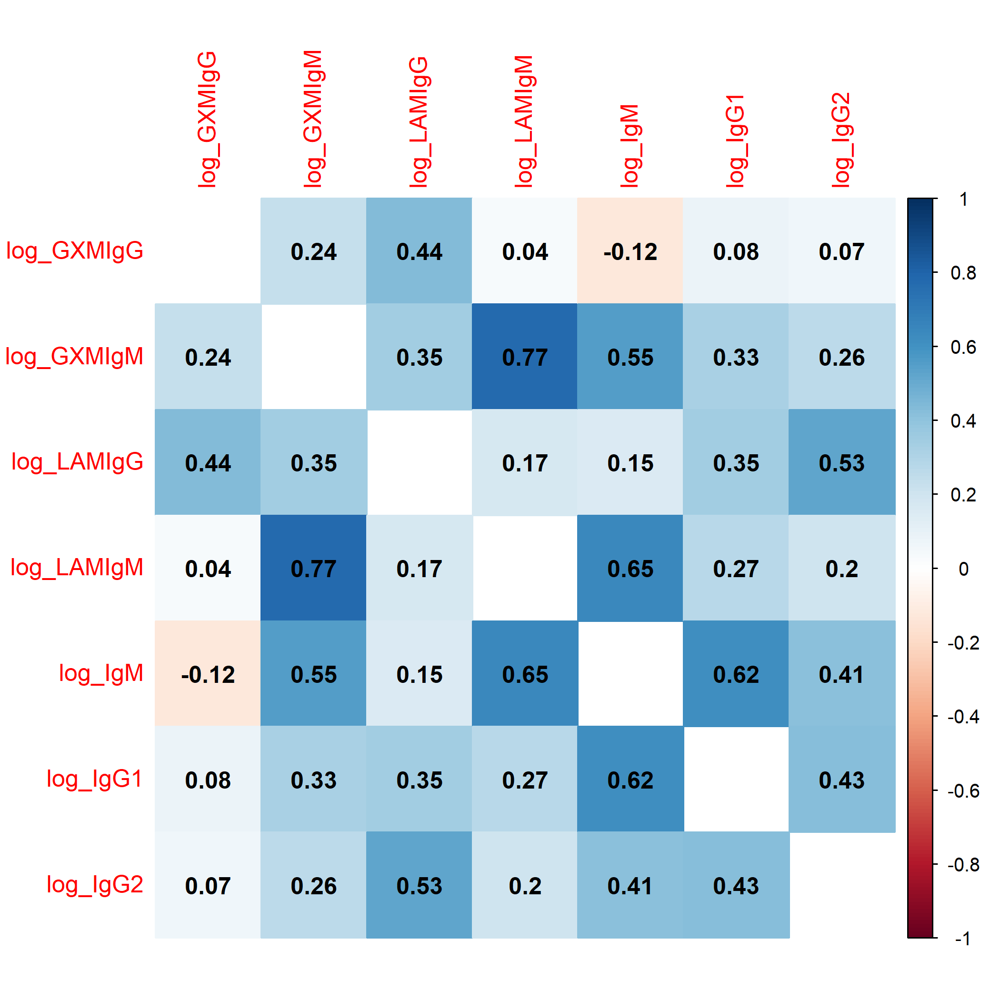
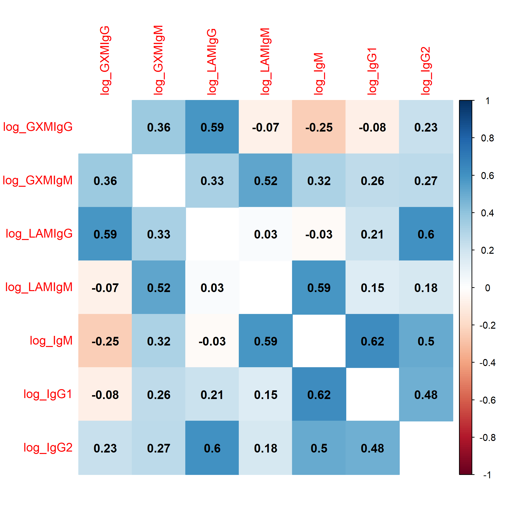
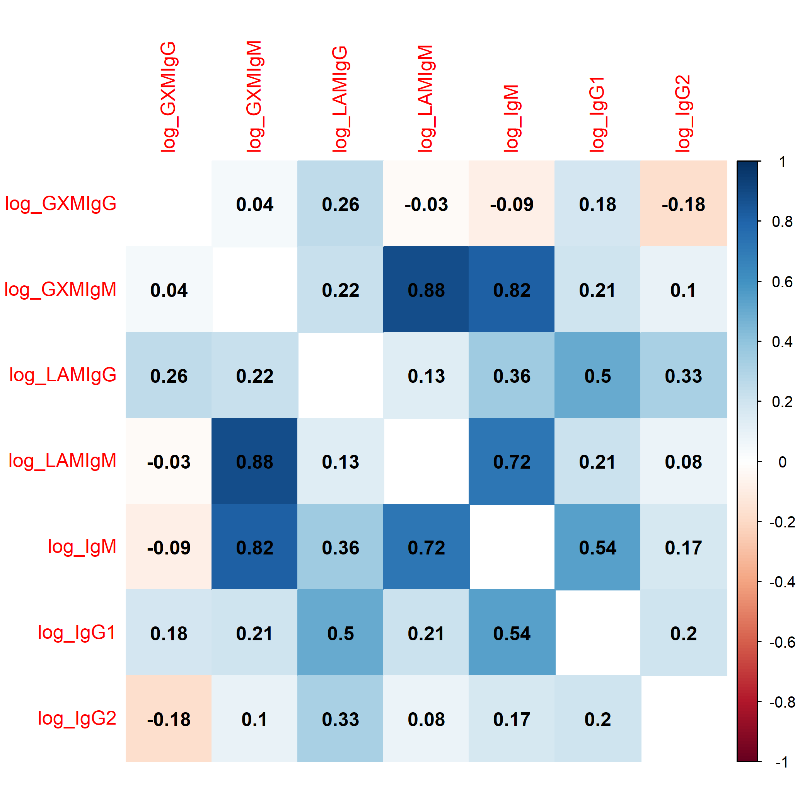
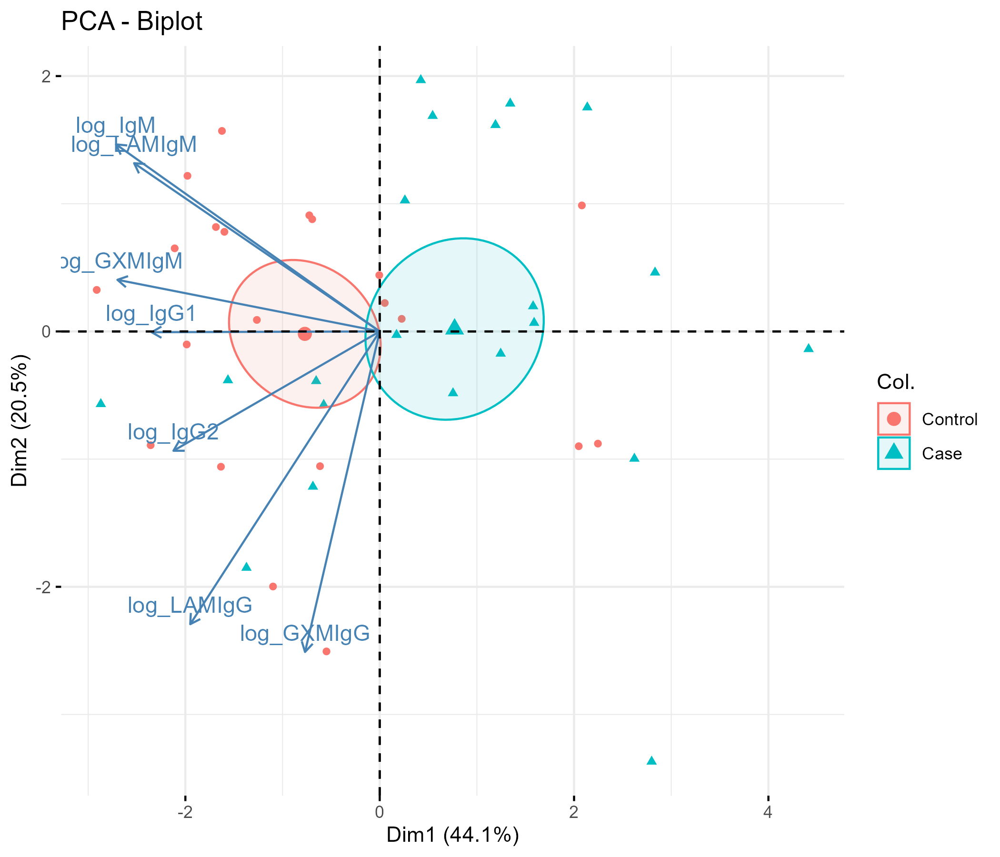
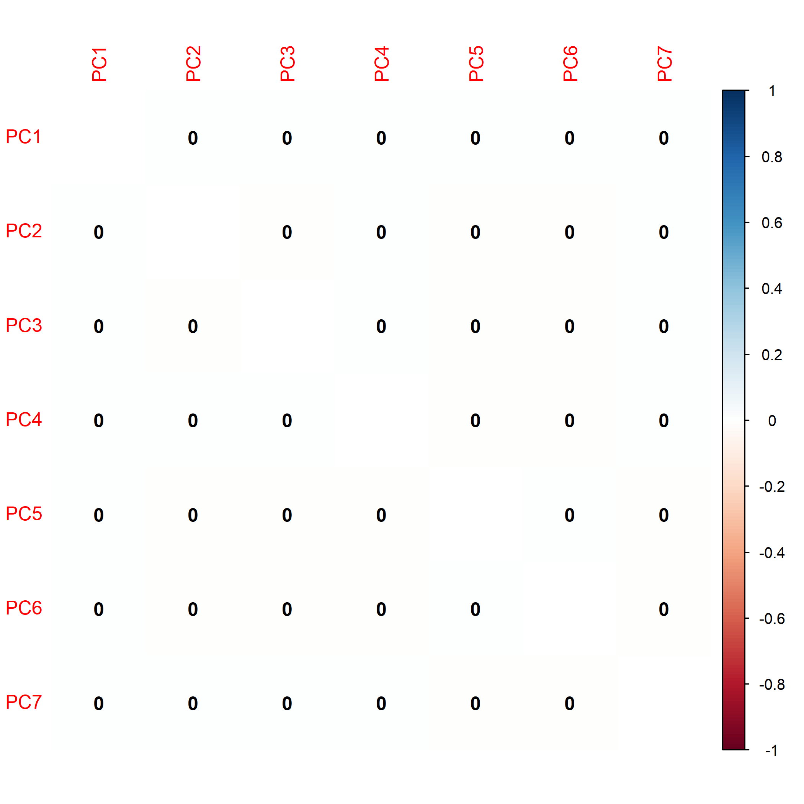

These are the tables and figures produced by running `R/main.R` on the study data. They were exported to `tables/` and `figures/` and are shown here as saved; this page does not rerun any analysis. The investigators have confirmed that these results are cleared for public release; they were published in *Open Forum Infectious Diseases* [@yoon2022antibody].

```{r}
#| include: false
#| eval: true
# Embed a saved table from tables/ directly in the page. Reads only the cleared
# HTML files; runs no analysis code.
show_table <- function(file) {
  html <- paste(readLines(file.path("..", "tables", file), warn = FALSE, encoding = "UTF-8"), collapse = "\n")
  body <- sub("(?s).*<body[^>]*>(.*)</body>.*", "\\1", html, perl = TRUE)
  body <- gsub('<h1 class="title toc-ignore">\\s*</h1>', "", body, perl = TRUE)
  body <- gsub('data-quarto-disable-processing="false"', 'data-quarto-disable-processing="true"', body, fixed = TRUE)
  knitr::asis_output(paste0("```{=html}\n<div style=\"overflow-x:auto;\">\n", body, "\n</div>\n```\n"))
}
```

```{=html}
<style>
.gt_table { font-size: 85% !important; }
.gt_table td, .gt_table th { white-space: nowrap; }
#refs { overflow-wrap: anywhere; }
</style>
```

::: callout-note
## Key findings

- **Cases had lower cryptococcus-binding IgM than controls:** median inverse titer of GXM-IgM 11 vs 42, and of Lam-IgM 49 vs 132. Lam-IgG was also lower (319 vs 589), as were total IgG1 (1,057 vs 1,516 µg/mL) and IgG2 (724 vs 1,097 µg/mL) [@yoon2022antibody].
- **Higher GXM-IgM and Lam-IgM were associated with lower odds of being a case.** In models including sex and either antibody, the odds ratio was 0.40 per natural-log unit of GXM-IgM and 0.33 for Lam-IgM. Because the two antibodies are strongly correlated (r = 0.77), neither was significant when both were in the same model.
- **Discrimination:** the area under the ROC curve was 0.80 for the model with sex and both antibodies, and 0.78 for the two antibodies without sex, comparable to the model including sex [@yoon2022antibody].
- **Interpretation:** the authors concluded that, together with previous studies, the findings "suggest the hypothesis that GXM/Lam-IgM may be beneficial in resistance to OTR-associated cryptococcosis". They suggested these antibodies may have diagnostic or prognostic value and called for a larger prospective study [@yoon2022antibody].

**Read with caution.**

- Blood was sampled once, at a non-standardized time *after* cryptococcosis was diagnosed (median 32 days, IQR 6–168), and there was no sample from before infection. The study cannot show cause and effect: lower antibody levels could be a consequence of infection or its treatment rather than a pre-existing risk factor, and the results do not show that these antibodies predict future disease.
- Cases and controls were not recruited concurrently and were not matched.
- AUCs and cutpoints were estimated and evaluated on the same 42 participants with antibody data, so they are optimistic [@ewald2006cutpoints].
- All analyses were exploratory, with no correction for multiple comparisons. The bootstrap confidence intervals involve random resampling and can differ slightly between runs.
:::

## Table 1

### All participants

```{r}
#| echo: false
#| eval: true
show_table("table1_all.html")
```

### Participants with antibody measurements

```{r}
#| echo: false
#| eval: true
show_table("table1_no_missing_titers.html")
```

Continuous variables were compared with the Wilcoxon rank-sum test and categorical variables with Fisher's exact or χ² tests. Median age was 56 in both groups. Counting multi-organ transplants toward each organ, 59% of participants had received a kidney, 23% a heart, 16% a liver and 7% a lung, with no difference between groups. Cases were more often women (39% vs 9.5%, p = 0.023) and less often Black (8.7% vs 33%, p = 0.064). Immunosuppression was similar, and all but one participant received a calcineurin inhibitor. Among cases, 48% had CNS cryptococcosis, and the median time from transplant to diagnosis was 1 year. Serum CrAg was positive in 21 of 23 cases and negative in all controls [@yoon2022antibody]. Antibody data were available for 42 participants (21 per group).

## Antibody levels by case status

{fig-alt="Seven panels comparing cases with controls for each antibody on a log scale. Medians were lower in cases for every antibody. Wilcoxon p-values: GXM-IgM 0.0013, Lam-IgM 0.0079, IgG1 0.03, Lam-IgG 0.052, IgG2 0.055, IgM 0.097, GXM-IgG 0.22. Points are individual participants, colored by transplanted organ and shaped by sex."}

Medians were lower in cases for all seven antibodies, most clearly GXM-IgM (p = 0.0013) and Lam-IgM (p = 0.0079), followed by IgG1 (p = 0.03). GXM-IgG did not differ (p = 0.22). IgG1 across the whole cohort was about 8-fold below normal adult levels [@yoon2022antibody].

## Logistic regression

### Original antibody scale

```{r}
#| echo: false
#| eval: true
show_table("regression_titer.html")
```

On this scale, an odds ratio describes a one-unit change in inverse titer or µg/mL, so every odds ratio is close to 1.00. Lam-IgM was significant on its own (p = 0.011) and with sex (p = 0.025). Because the antibodies span several orders of magnitude, the models were repeated on the log scale.

### Log antibody scale

::: {.column-page-right}
```{r}
#| echo: false
#| eval: true
show_table("regression_log_titer_models1_2.html")
```
:::

Odds ratios for log-transformed antibodies are per one natural-log unit, about a 2.7-fold difference in titer or concentration. The univariable models use all 44 participants for non-antibody variables and the 42 with antibody data for antibodies; the multivariable models use the 42 with antibody data.

In univariable models, higher GXM-IgM (OR 0.41) and Lam-IgM (OR 0.36) were each associated with lower odds of being a case (both p = 0.007), and female sex with higher odds (OR 6.11). With both antibodies in one model, with sex (model 1) or without (model 2), neither was significant, because the two are strongly correlated (r = 0.77).

### Sensitivity analysis: one antibody at a time

```{r}
#| echo: false
#| eval: true
show_table("sensitivity_log_lam_igm.html")
```

```{r}
#| echo: false
#| eval: true
show_table("sensitivity_log_gxm_igm.html")
```

Fitted separately, each with sex, Lam-IgM (OR 0.33) and GXM-IgM (OR 0.40) were both associated with lower odds of being a case (p ≈ 0.01). Each 2.7-fold higher titer corresponded to 60–67% lower odds.

## ROC curves

::: {layout-ncol="3"}
{fig-alt="ROC curve for the model with sex and Lam-IgM on the original scale; area under the curve 0.766."}

{fig-alt="ROC curve for model 1 (sex, log Lam-IgM and log GXM-IgM); area under the curve 0.803."}

{fig-alt="ROC curve for model 2 (log Lam-IgM and log GXM-IgM, without sex); area under the curve 0.776."}
:::

```{r}
#| echo: false
#| eval: true
show_table("auc_confidence_intervals.html")
```

The model with sex and both log antibodies had an AUC of 0.80 (bootstrap 95% CI 0.66–0.91). A second model without sex, fitted to check that sex was not driving discrimination, had a similar AUC of 0.78 (0.61–0.91). As in the paper, the bootstrap intervals use 2000 stratified replicates; DeLong intervals are shown for comparison [@yoon2022antibody].

## Optimal cutpoints

A test result is "positive" (suggesting cryptococcosis) when the antibody is **at or below** the cutpoint. Cutpoints are given as inverse titers on the original scale (for example, 25 corresponds to a titer of 1:25) or as natural-log values.

```{r}
#| echo: false
#| eval: true
show_table("optimal_cutpoints.html")
```

For GXM-IgM, an inverse titer of 25 or below gave sensitivity 0.91 and specificity 0.67. For Lam-IgM, 158 or below gave sensitivity 0.95 and specificity 0.48. The log-scale cutpoints are the same thresholds (e^3.23 ≈ 25, e^5.06 ≈ 158), so their performance is identical.

## Correlation between antibodies

::: {layout-ncol="3"}
{fig-alt="Correlation matrix of the seven log antibody levels, all participants with antibody data. Strongest correlations: GXM-IgM with Lam-IgM 0.77, Lam-IgM with IgM 0.65, IgM with IgG1 0.62, GXM-IgM with IgM 0.55."}

{fig-alt="Correlation matrix for cases. Strongest: IgM with IgG1 0.62, Lam-IgG with IgG2 0.60, GXM-IgG with Lam-IgG 0.59, Lam-IgM with IgM 0.59; GXM-IgM with Lam-IgM 0.52."}

{fig-alt="Correlation matrix for controls. Strongest: GXM-IgM with Lam-IgM 0.88, GXM-IgM with IgM 0.82, Lam-IgM with IgM 0.72."}
:::

Pearson correlations of the log antibody levels; the plot for all participants is Supplementary Figure 2 of the paper [@yoon2022antibody]. GXM-IgM and Lam-IgM were the most strongly correlated pair (r = 0.77), more so in controls (0.88) than in cases (0.52).

## Principal component analysis

```{r}
#| echo: false
#| eval: true
show_table("pca_eigenvalues.html")
```

::: {layout-ncol="2"}
{fig-alt="Participants plotted on the first two principal components (44.1% and 20.5% of variance). Cases lie mostly to the right and controls to the left, with overlapping confidence ellipses around the group means."}

{fig-alt="Same plot with an arrow for each log antibody. All arrows point left, so the right side (where cases sit) corresponds to lower antibody levels. IgM, Lam-IgM and GXM-IgM point up-left; IgG2, Lam-IgG and GXM-IgG point down-left."}
:::

{width="50%" fig-alt="Correlation matrix of the seven principal component scores; all correlations between different components are 0."}

This is a check, not a result. PCA constructs the components to be uncorrelated, so every correlation between two different components is exactly 0. The diagonal, each component with itself, is left blank. The plot confirms that all seven components can enter one regression model together.

```{r}
#| echo: false
#| eval: true
show_table("regression_principal_components.html")
```

PCA re-expresses the seven correlated antibody levels as seven uncorrelated components, keeping as much of the variation as possible in the first few. PC1 explains 44% of the variation, and PC1 and PC2 together explain 65%. Every antibody points the same way on PC1, so it measures overall antibody level, with the sign inverted. PC2 separates IgG from IgM. Cases sit mostly on the low-antibody side. In a model with all seven components (Supplementary Table 2 of the paper), each one-unit higher PC1, meaning lower overall antibody, was associated with about twice the odds of being a case (OR 2.08, 95% CI 1.30–3.88, p = 0.007). No other component was significant [@yoon2022antibody].

## Context

About 75% of participants received mycophenolate, which may affect the B cells that make these antibodies. Calcineurin inhibitors suppress B-cell responses but have also shown anti-cryptococcal activity [@yoon2022antibody].

## References

::: {#refs}
:::
